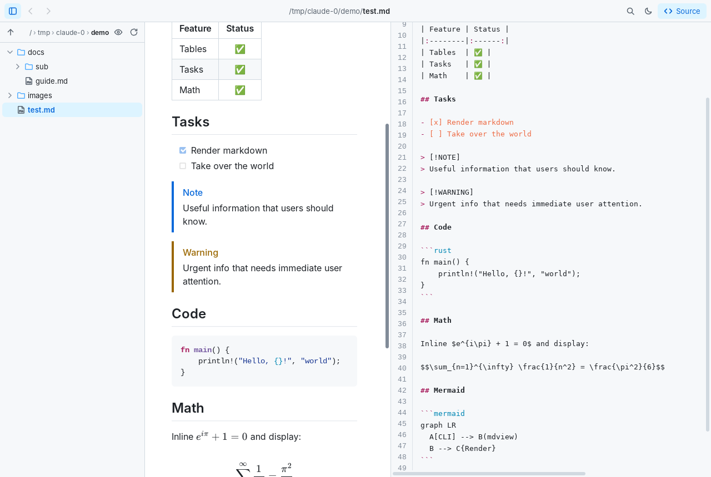
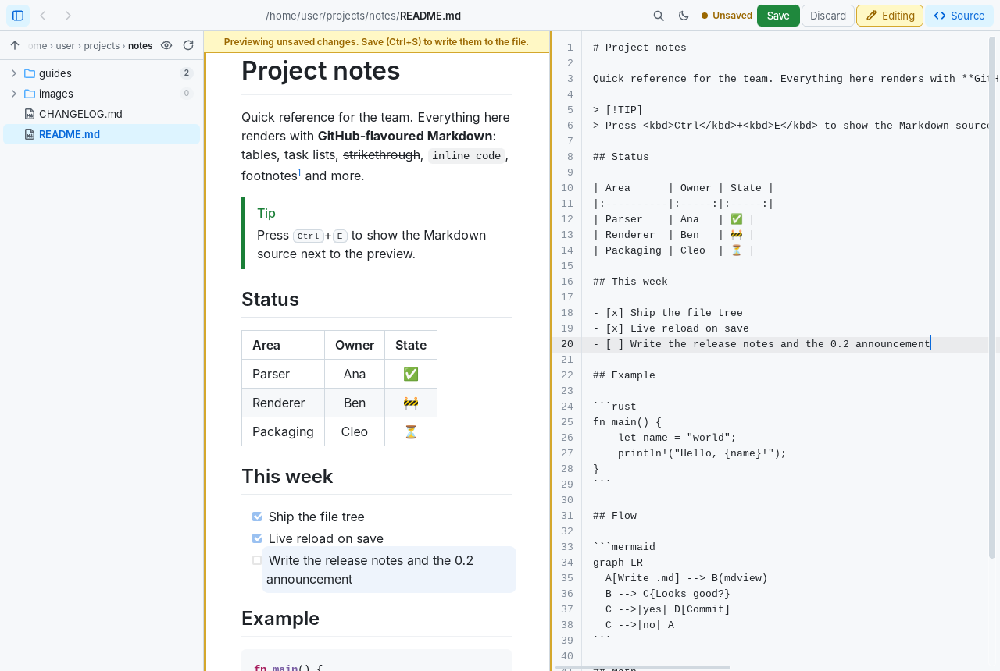
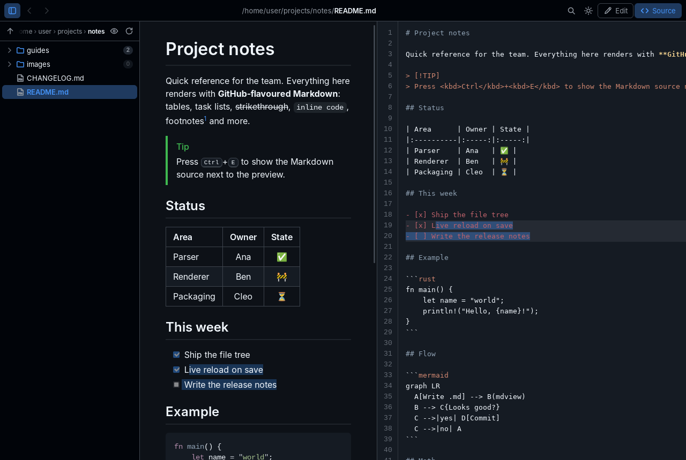
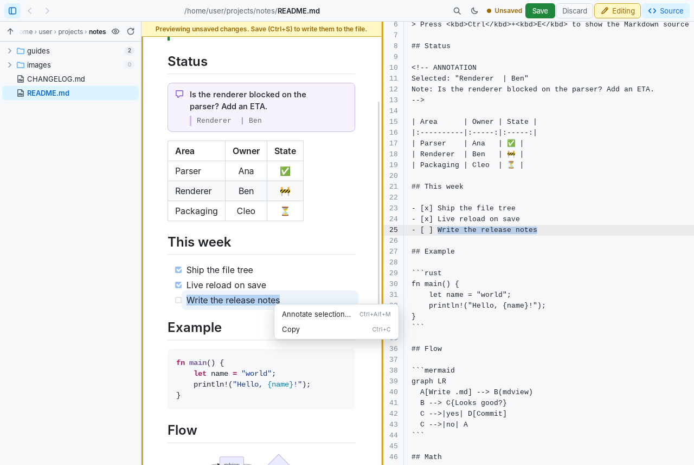

#  mdview

A small, fast Markdown viewer for macOS, Windows and Linux. You open it from the terminal the same way you'd use `code`:

```sh
mdview README.md      # open a file
mdview docs/          # open a folder (shows its README.md if there is one)
mdview                # browse the current folder
```



## Features

- **GitHub-flavoured Markdown.** Tables, task lists, strikethrough, autolinks, footnotes, alerts (`> [!NOTE]`), emoji shortcodes (`:tada:`), heading anchors and raw HTML (sanitized, see [Security](#security)).
- **Syntax highlighting** for fenced code blocks. Each block gets a copy button.
- **Mermaid diagrams** and **math** (`$inline$`, `$$display$$` and ` ```math ` blocks) via bundled Mermaid and KaTeX. Both work offline.
- **File tree** on the left. It opens at the file's folder. Click a folder to expand it, double-click it (or use a breadcrumb) to make it the root, and use ↑ or <kbd>Backspace</kbd> to go up a level. The 👁 button shows non-Markdown files too. Each folder shows a badge with how many Markdown files it holds, subfolders included (0 means none).
- **Source pane** on the right (<kbd>Ctrl/Cmd+E</kbd>). It shows the raw Markdown with line numbers and highlighting, and scrolls in sync with the preview. Selection works both ways. Select or click lines in it to highlight the matching blocks in the preview, or select text in the preview to highlight the matching source text.
- **Basic editing.** Click **Edit** to unlock the file. The source pane becomes a plain text editor, and the preview updates as you type. Nothing is written until you click **Save** (<kbd>Ctrl/Cmd+S</kbd>). Until then an amber *Unsaved* marker, a banner over the preview and a dot in the window title show that the preview isn't what's on disk. **Discard** reverts to the saved file (with an Undo). Locking, switching files or closing with unsaved changes asks whether to save or discard them. The editor has line numbers and highlights the cursor line or selected lines, and the preview gently highlights the matching blocks. Selecting text in the preview selects the matching text in the editor, and clicking in the preview moves the editor's cursor there.
- **Annotations for AI agents.** Select text in the preview, editor or source pane, right-click and choose **Annotate selection…** (<kbd>Ctrl/Cmd+Alt+M</kbd>), then type a note. The note goes into the file as an HTML comment above the block you selected. See [Annotations](#annotations). The preview shows each note as a card with a **Resolve** button that removes it. Like any edit, notes are only written when you click Save.
- **Live reload.** When another program changes the open file, the preview refreshes and keeps your scroll position. Folders shown in the tree update too.
- Light and dark themes (follows the OS; toggle with <kbd>Ctrl/Cmd+L</kbd>), zoom, find-in-page, back/forward history, and drag-and-drop to open a file.
- Relative links to other `.md` files open inside mdview. Web links open in your browser. Local images load as you'd expect.
- About 10 MB as a single binary. It uses the system webview (WebView2, WKWebView or WebKitGTK), so nothing like Electron gets bundled.

## Screenshots

**Editing.** The source pane turns into an editor and the preview follows as you type. Until you save, the toolbar, a banner over the preview and the window title show that there are unsaved changes. The cursor line is highlighted in both panes.



**Dark theme and two-way selection.** Text selected in the preview is highlighted in the source pane, and the other way round.



## Annotations

Annotations let you mark up a document for someone else to act on, typically an AI coding agent. Each note is stored as an HTML comment just above the block it refers to. GitHub and other Markdown viewers hide it, while anything that reads the file sees it plainly:

```markdown
<!-- ANNOTATION
Selected: "ship the **new parser** next week"
Note: Check the date with the security team first
-->

We will ship the **new parser** next week, after the security review is done.
```

A selection over several lines is quoted with `> ` lines. To hand the notes to an agent, save the file and ask something like:

> Find the annotations in docs/plan.md with `grep -n "<!-- ANNOTATION" docs/plan.md`, read only the lines around each one, apply each note to the selected text, then delete the comment. Work from the bottom of the file up so line numbers stay valid.

On a long document this saves the agent from reading the whole file. Resolving a note is just deleting its comment, so nothing else needs to be kept in sync.



## Install

### Prebuilt binaries

Download the archive for your platform from [Releases](https://github.com/JayDoubleu/mdview/releases), extract it, and put `mdview` somewhere on your `PATH`. Every commit also builds binaries in [GitHub Actions](https://github.com/JayDoubleu/mdview/actions); look under Artifacts on any green run.

- **Builds:** Linux (x86_64, ARM64), macOS (one universal binary for Apple Silicon and Intel) and Windows (x86_64, ARM64).
- **macOS:** the binary isn't signed, so clear the quarantine flag once: `xattr -d com.apple.quarantine ./mdview`.
- **Windows:** needs the WebView2 runtime, which ships with Windows 10 and 11.
- **Linux:** needs WebKitGTK 4.1 (`sudo apt install libwebkit2gtk-4.1-0`, `sudo dnf install webkit2gtk4.1`, or `sudo pacman -S webkit2gtk-4.1`).

### From source

You need [Rust](https://rustup.rs) 1.85 or newer.

```sh
# Linux only: build dependencies
sudo apt install libwebkit2gtk-4.1-dev libgtk-3-dev      # Debian / Ubuntu
sudo dnf install webkit2gtk4.1-devel gtk3-devel          # Fedora
sudo pacman -S webkit2gtk-4.1 gtk3                       # Arch

cargo install --locked --git https://github.com/JayDoubleu/mdview
```

Or clone the repo and run `cargo install --locked --path .`. Either way the binary lands in `~/.cargo/bin`.

> [!NOTE]
> mdview isn't published on crates.io. The `mdview` crate there is an unrelated project, so `cargo install mdview` installs something else.

## Usage

```
mdview [PATH]

  -n, --new-window Open a new window instead of using the one already open
  -w, --wait       Keep the terminal attached until the window is closed
                   (always opens a new window)
  -h, --help       Print help
  -V, --version    Print version
```

Like `code`, mdview uses one window. Running `mdview other.md` while it's open shows that file in the open window and brings it to the front. If you have unsaved edits there, it asks first. `mdview some/folder` switches the window's file tree to that folder. Pass `--new-window` for a separate window.

`mdview` hands the terminal back straight away. Pass `--wait` if you want it to block until the window closes.

| Shortcut (Cmd on macOS) | Action |
|---|---|
| <kbd>Ctrl+B</kbd> | Toggle file tree |
| <kbd>Ctrl+E</kbd> | Toggle source pane |
| <kbd>Ctrl+F</kbd> | Find in document |
| <kbd>Ctrl+S</kbd> | Save (while editing) |
| <kbd>Ctrl+L</kbd> | Toggle light / dark |
| <kbd>Ctrl+R</kbd> | Reload |
| <kbd>Ctrl+=</kbd> / <kbd>Ctrl+-</kbd> / <kbd>Ctrl+0</kbd> | Zoom in / out / reset |
| <kbd>Alt+←</kbd> / <kbd>Alt+→</kbd> | Back / forward |
| <kbd>Backspace</kbd> | Tree: go up one folder |
| <kbd>Ctrl+W</kbd> / <kbd>Ctrl+Q</kbd> | Close |

On Linux, mdview turns off WebKitGTK's animated wheel scrolling because it feels laggy. Set `MDVIEW_SMOOTH_SCROLL=1` to bring it back. On NVIDIA drivers it also sets `WEBKIT_DISABLE_DMABUF_RENDERER=1`, which avoids WebKitGTK's well-known stutter there, unless you've set that variable yourself.

On Linux, mdview adds itself to your applications menu the first time it runs, so desktops (including Wayland ones, which take window icons from there) show its icon. It writes `~/.local/share/applications/mdview.desktop` and `~/.local/share/icons/hicolor/{scalable,256x256}/apps/mdview.*`, and updates them if the binary moves. Set `MDVIEW_NO_DESKTOP_ENTRY=1` to skip this, and delete those files to undo it. If you customize the entry, remove its `X-Mdview-Generated=true` line and mdview will leave it alone. Builds run from a cargo `target/` folder don't touch it.

You can drag the dividers to resize the panes. mdview remembers pane sizes, theme and zoom between runs.

## Security

mdview is meant to be safe to point at Markdown you didn't write, such as a README in a freshly cloned repository.

- Raw HTML is sanitized with an allowlist, much like GitHub does. Scripts, iframes, forms, event handlers and `javascript:` links are removed.
- Local files a document references (images, video) are served under a sandboxing Content Security Policy, and HTML or JavaScript files are only ever served as plain text, so they can't run.
- Links to web pages open in your browser. Links to local files only open harmless types (images, PDFs, text and similar). For anything else, such as scripts or executables, mdview opens the containing folder instead of running it.
- Remote images in documents load directly, as in a browser, so the image host can see that the document was opened.

## How it works

- `src/main.rs` creates the window ([tao](https://github.com/tauri-apps/tao)) and the webview ([wry](https://github.com/tauri-apps/wry)), watches the open file's folder ([notify](https://github.com/notify-rs/notify)), and handles the CLI.
- `src/server.rs` serves a `mdview://` custom protocol. It provides the embedded UI assets plus a small JSON API for listing folders, rendering files and loading local images.
- `src/render.rs` renders Markdown with [comrak](https://github.com/kivikakk/comrak) (GFM extensions) and highlights code with [syntect](https://github.com/trishume/syntect).
- `assets/` holds the UI (plain HTML, CSS and JS, no build step) and the vendored Mermaid and KaTeX. `build.rs` embeds all of it into the binary.

## Development

```sh
cargo run -- README.md   # debug build; right-click the page for the web inspector
cargo test
cargo fmt --check
cargo clippy --all-targets -- -D warnings
```

CI runs the same checks on Linux, macOS and Windows. Pushing a `v*` tag publishes a GitHub Release with binaries for all three.

## License

MIT. Bundled third-party code: Mermaid (MIT) and KaTeX (MIT). Their license files are in `assets/vendor/`.
